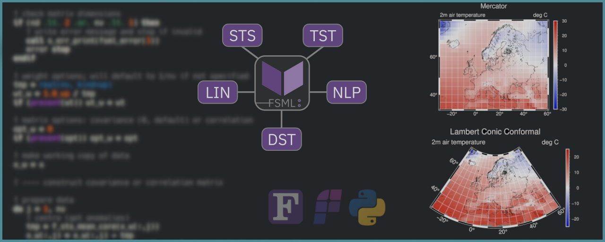

Development
===========

We develop software, models, and educational resources with an emphasis on openness and easy-of-access. All developed models, resources and tools are open-source, open-access and available for free (mostly MIT or cc-by licensed).

FSML - Fortran Statistics and Machine Learning
..............................................

FSML (Fortran Statistics and Machine Learning) is a scientific toolkit consisting of common statistical and machine learning procedures, including basic descriptive statistics (e.g., mean, variance, correlation), common statistical tests (e.g., t-test, Mann–Whitney U), linear models (e.g., multiple OLS regression), and non-linear algorithmic statistical and machine learning procedures (e.g., k-means clustering).

Key features:

- Common statistics and machine learning techniques (as used in modern research).
- Familiar/intuitive interface (similarities to popular Python or R libs).
- Core procedures are kept pure (to simplify parallelisation and testing), while impure wrappers handle optional arguments and errors for safe conventional use.
- Minimal requirements/dependencies (Fortran 2008 or later, and stdlib).

.. seealso::

   The source code is hosted in a GitHub repository `here <https://github.com/sebastian-mutz/fsml/>`_. Its online documentation can be viewed `here <https://fsml.mutz.science/>`_. The associated publication in the Journal of Open Source Software can be read `here <https://doi.org/10.21105/joss.09058>`_.

FPLT - Fortran Plotting Library
...............................

FPLT is a a scientific plotting library for producing high-quality ("publication-ready") figures quickly by leveraging the GMT(Generic Mapping Tools) C-API and modern Fortran's derived types. FPLT includes procedures for producing geographical maps, xy-plots, heat maps, animated figures, and more. FPLT includes a Fortran interface for several GMT modules (using GMT’s C API). Additional features, provided through an abstraction layer, include Fortran derived types for colour maps, font management, and options for specific kinds of plots. Furthermore, FPLT includes procedures for the automatic construction of colour maps and (the infamously cryptic) GMT argument strings from pre-defined or user-defined options.

The aim is to create a library that lets you:

- visualise your data directly from your Fortran programme though familiar Fortran-native constructs,
- produce professional figures quickly through the use of templates and automatic argument construction,
- modify or create new templates easily from your programme.

The entire project is hosted on `GitHub <https://github.com/sebastian-mutz/fplt/>`_.

.. seealso::

   The source code is hosted in a GitHub repository `here <https://github.com/sebastian-mutz/fplt/>`_.

pyESD - Empirical-Statistical Downscaling
.........................................

PyESD is an open-source framework for empirical-statistical downscaling (ESD) of any climate-related variable like rainfall, temperature, and wind speed. The software package implements the whole downscaling cycle, including data preprocessing, predictor selection, constructions, model selection, training, validation and evaluation, and prediction. It includes a range of methods, including well-established multivariate statistical methods, as well as techniques from Machine Learning. The package serves as the means of downscaling General Circulation Models of future climate to high resolution relevant for climate impact assessment such as droughts, flooding, wildfire risk, and others. The model code is available through `GitHub <https://github.com/Dan-Boat/PyESD>`_. The associated publication in *Geoscientific Model Development* can be found `here <https://gmd.copernicus.org/articles/16/6479/2023/>`_ (Boateng and Mutz, 2023).

.. seealso::

   The full documentation of the package, including tutorials and example applications, can be found `here <https://dan-boat.github.io/PyESD/>`_.

INTEGRATE - Climate Science Teaching Package
............................................

INTEGRATE (INTEGRation of Atmospheric science, Technical and Empirical methods) is an open-access, open-source teaching package that covers the topics of physical climatology, empirical methods and a hands-on approach of collecting and analysing atmospheric data. It promotes an interdisciplinary and didactically multifaceted approach to learning about climatology, modern empirical methods and programming. It comprises a crash course in theory and hands-on approach to collecting atmospheric data and working with readily available climatological records on real problems. This course requires no prior knowledge of the topics covered in the course. The following resources are included in the course and packaged into a single `GitHub repository <https://github.com/sebastian-mutz/integrate>`_:
(1) Accessible graphics and notes for learning about climate science. These are divided into chapters („Building a Climate“), which can be taught as a lecture series or studied as a virtual introductory text to physical climatology.
(2) Materials for the exercise series (including solutions to posed problems, data and code) and tested ideas for group projects.
(3) All code required to compile the teaching materials into a complete course website.
The project was supported by the European Geosciences Union and is listed in the `EGU teaching resources <https://www.egu.eu/education/resources/342/integrate-integration-of-atmospheric-science-technical-and-empirical-methods/>`_.

.. seealso::

   A full demonstration and explanation of the teaching package can be found on a compiled version of the course website that is hosted `here <https://integrate.mutz.science>`_.

.. FACT - Fortran Atmospheric Model for Complex Terrain
.. ....................................................
..
.. .. figure:: img/FACT_dark.png
..    :align: left
..
.. FACT (Fast/Fortran Atmospheric Model for Complex Terrain) is an intermediate complexity model for downscaling climate in complex terrain (such as mountain regions). It combines process-based and empirical modelling. For rainfall, the former uses mountain wave theory and builds on the works of Smith and Barstad (2004) and Hergarten and Robl (2022). The latter uses parameter optimisation techniques and concepts from model output statistics. The model is still in early development. It is designed to work as a module for fast post-processing of climate model output.
